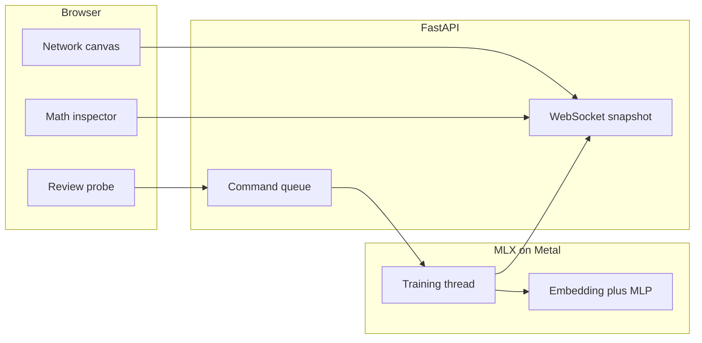

# Metal Network Visualiser

A local studio: the browser is the instrument, Python on this M3 Max is the Metal trainer. The browser cannot see Metal, so training stays in MLX and the UI only receives small snapshots.

This machine is an Apple M3 Max (30 GPU cores, 36 GB unified memory, Metal supported). MLX is not installed yet; the app will run it from a project virtualenv.

## Architecture

- **Trainer:** [MLX](https://ml-explore.github.io/mlx/) (`mlx.core.metal.device_info()`, `mlx.nn`). One thread owns the model. The API only posts commands (`configure`, `start`, `pause`, `step`, `reset`, `predict`) so weights are never touched from two threads.
- **UI:** Vite, React, TypeScript. The graph, heatmaps, and charts draw on canvas and read snapshots through refs. React renders chrome only, so a telemetry tick does not reconcile thousands of edges.
- **Link:** FastAPI WebSocket. The server keeps the latest snapshot and drops stale frames. System stats at 2 Hz. While running, a traced example at about 8 Hz. Full small weight matrices only when they change and only if the layer is small.

## The model, chosen so the math is the picture

IMDB is binary sentiment (0 negative, 1 positive). A transformer would hide the operations. The network is a mean-pooled embedding plus a shallow MLP, every step an explicit gather or GEMM:

1. Tokens gathered from the embedding matrix \(E\)
2. Mean pool \(\bar{e} = \frac{1}{T}\mathbf{1}^\top E_{\text{rows}}\), shown as that average, not as a magic block
3. Hidden layers \(z = hW + b\), then ReLU
4. Logit, sigmoid, binary cross-entropy with logits
5. Backward as the matching transposed products: \(\partial L/\partial W = h^\top \delta\), \(\delta_{\text{prev}} = (\delta \odot \mathrm{ReLU}'(z)) W^\top\)
6. Update rule on screen: Adam by default, SGD selectable, with the formula for the one in use

Defaults, sized so every hidden unit is a real node: vocab 12,000, sequence 256, embed 48, hidden 64 then 32, output 1. About 5,000 edges. Canvas draws all of them. Above that, the view keeps every neuron up to 96 units per layer and draws the strongest incoming weights per neuron rather than every edge.

Embedding rows are not 12,000 nodes. The input column is the 48-d pooled vector. The embedding itself is a row-lookup: the traced review’s token ids light the rows that were gathered.

Architecture, learning rate, batch size, epochs, optimizer, and seed are editable until the first step. After that they lock until reset.

## What training sends, and what it refuses to send

Per step, always: loss, batch accuracy, learning rate, step, epoch, examples per second.

Every few steps, one review from the batch is traced without blocking the optimizer for long:

- Token ids and the short review text
- Pooled vector and each layer’s pre-activation, activation, and bias (these vectors are tiny)
- Full \(W\) and \(b\) for hidden layers (64×48 and 32×64 are small)
- Embedding: only the rows that review used, plus a per-row norm summary
- Gradient RMS, weight mean and standard deviation per parameter

The matmul animation does not run on the GPU. The inspector plays back the snapshot: pick an output unit and scrub the dot product \(z_j = h \cdot W_{:j} + b_j\), with the input row and weight column highlighted, next to heatmaps of \(h\), \(W\), and \(z\). Forward, weights, backward, and update are segments of the same inspector. KaTeX formulas use the live shapes.

Running at full speed stays fast because Metal never waits on the canvas. **Step** runs one batch and holds the snapshot so the dot-product scrubber can be read slowly. **Pause** freezes training and leaves the last frame on screen.

## Dataset

Stanford ACL IMDB, downloaded once into `data/raw` (about 80 MB) with progress in the toolbar. A small word tokenizer builds a frequency vocab, caches tokenized arrays in `data/cache`, and the Data section of the inspector shows class balance plus the traced review with its label. No PyTorch, no Hugging Face stack.

Checkpoints go to `data/checkpoints` with MLX `save_weights`, so a later launch can probe without retraining.

## Probe

A sheet opened from **Try a review**, spring-driven, no dimming scrim (it is a side task, not a modal trap). The transcript is a chat: the user sends text, the network answers `0` or `1`, the probability, and the label in words. Untrained weights are allowed and marked untrained, so a guess near one half is visible. Prediction is a command on the training thread.

## System line

Toolbar chip, readable before training starts: GPU name, architecture, and unified memory from `mx.metal.device_info()` — on this Mac, the M3 Max. Beside it, process and system CPU, unified memory used, MLX active and peak Metal memory, and GPU utilization when IOKit `AGXAccelerator` performance statistics expose it. If utilization is missing, memory and device identity still show; the UI does not invent a percent. If Metal is unavailable, training does not start.

## Interface, following the Apple design rule

Dark and light from `prefers-color-scheme`. System font. The network canvas is the content; a translucent toolbar floats over it (`backdrop-filter`, brighter top edge). The inspector is a lighter material panel, not a second translucent sheet stacked on the toolbar. Large figures (loss, probability) use tight leading and negative tracking.

Motion from the `motion` library: critically damped springs for layout, a little bounce only when the probe sheet is flung. Buttons scale on pointer-down. The sheet tracks the pointer, rubber-bands, and projects the release. Particles on the graph are the traced example’s activations traveling layer to layer; under `prefers-reduced-motion` they disappear and the canvas cross-fades between snapshots. `prefers-reduced-transparency` drops the blur and turns materials solid.

Color is restrained: one accent for controls, a diverging scale only for weight sign, a single ramp for activation magnitude, and the sentiment label as text first.

## Layout of the repo

- [backend/app/main.py](backend/app/main.py) — FastAPI, WebSocket, command API
- [backend/app/model.py](backend/app/model.py) — embedding, pool, MLP, loss
- [backend/app/train.py](backend/app/train.py) — thread, step, trace, checkpoint
- [backend/app/data.py](backend/app/data.py) — IMDB download, vocab, batches
- [backend/app/system.py](backend/app/system.py) — Metal device info, psutil, IOKit
- [frontend/src/studio/NetworkCanvas.tsx](frontend/src/studio/NetworkCanvas.tsx) — nodes, edges, particles
- [frontend/src/studio/Inspector.tsx](frontend/src/studio/Inspector.tsx) — formulas, heatmaps, dot-product scrubber
- [frontend/src/studio/ProbeSheet.tsx](frontend/src/studio/ProbeSheet.tsx) — review transcript
- [README.md](README.md) — one command to install and two processes to run

A `scripts/dev.sh` starts the API and Vite together. Vite proxies REST and the WebSocket.
